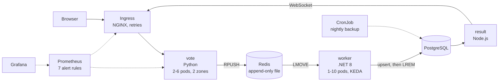
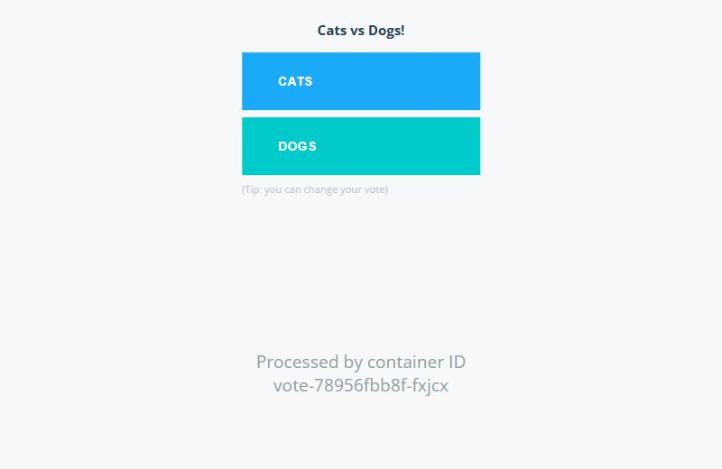
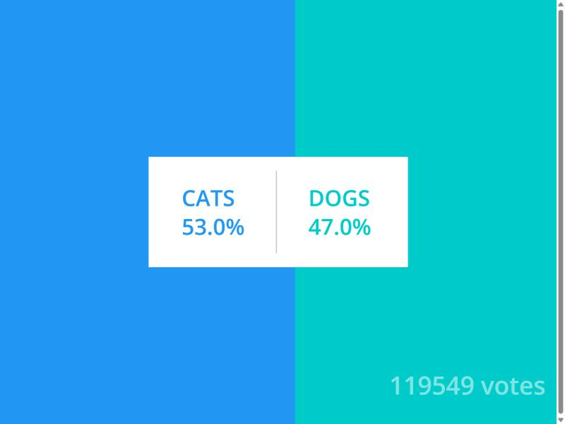
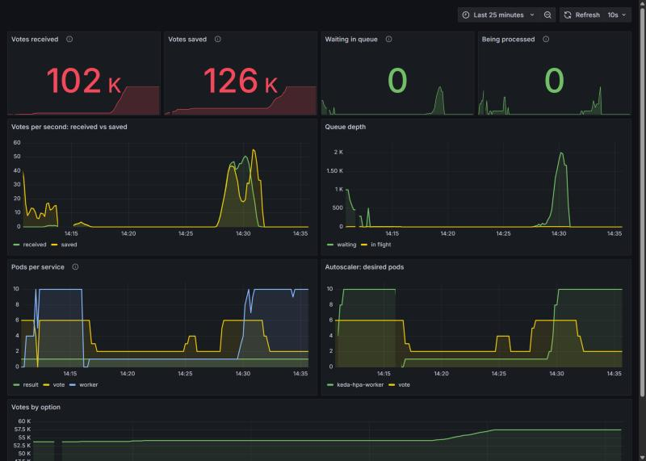
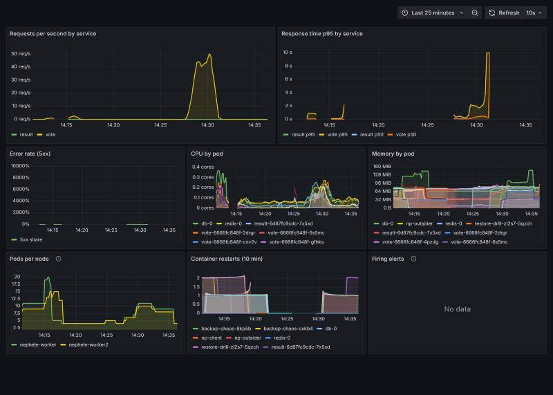
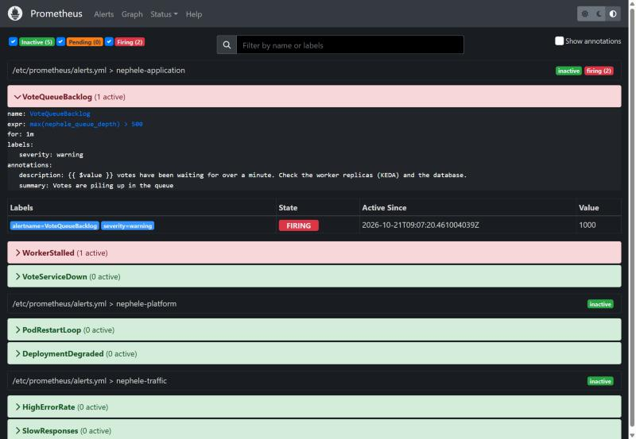
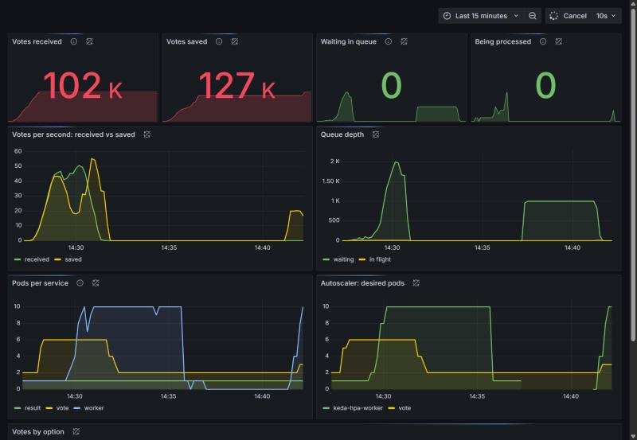

# Nephele: a fault-tolerant voting platform on Kubernetes

[](https://github.com/gauravgoodreads/nephele/actions/workflows/nephele-ci.yml)

Nephele runs a small microservices application the way production systems
run: on a 3-node Kubernetes cluster spread over two zones, scaling on load,
healing itself, monitored with alert rules, locked down with strict security
policy, and released by a pipeline that builds a real cluster and breaks it
on purpose before anything ships. The same files run it live on AWS (EKS, RDS,
ElastiCache), built by Terraform.

> **Credit.** The voting application (`vote`, `worker`, `result`) comes from
> Docker's open-source [example-voting-app](https://github.com/dockersamples/example-voting-app)
> (Apache License 2.0); its README is kept in [docs/UPSTREAM_README.md](docs/UPSTREAM_README.md).
> Nephele's work is the reliable-queue rewrite of the worker, fixes to bugs
> found in the original code, and the whole platform around it.

## Architecture



A vote is answered as soon as it is on the queue. A worker **moves** it into
its own processing list, saves it with an upsert, and only then removes it, so
a crash at any point loses nothing and a retry is harmless
([ADR 0003](docs/adr/0003-reliable-queue-at-least-once.md)).

## Screenshots

Taken on the 3-node kind cluster, 21 Oct 2026 ([all of them](docs/screenshots/)).

| | |
| --- | --- |
|  |  |
|  |  |

**Alert drill.** Workers paused and 1,000 votes queued: `VoteQueueBacklog`
and `WorkerStalled` fire after a minute. Workers resumed: KEDA scales them to
10, the queue empties and both alerts clear on their own.




## Run it

### Kubernetes on your laptop (recommended)

Needs Docker Desktop, [kind](https://kind.sigs.k8s.io/) and `kubectl`.

```bash
scripts/kind-up.sh            # Git Bash, macOS, Linux
```
```powershell
powershell -ExecutionPolicy Bypass -File scripts\kind-up.ps1   # Windows
```

One command creates the 3-node cluster, installs the NGINX Ingress controller,
metrics-server and KEDA, builds and loads the images, and deploys Nephele and
the monitoring stack.

| | |
| --- | --- |
| Vote | http://vote.localtest.me:8888 |
| Results | http://result.localtest.me:8888 (JSON: `/api/results`) |
| Grafana | http://grafana.localtest.me:8888 |
| Prometheus | http://prometheus.localtest.me:8888 (Alerts tab) |

Remove it with `kind delete cluster --name nephele`.

### Docker Compose

```bash
docker compose -f docker-compose.nephele.yml up -d --build
docker compose -f docker-compose.nephele.yml --profile monitoring up -d
```

Vote http://localhost:8080, results http://localhost:8081, Grafana http://localhost:3300.

## Prove it

| Command | What it does |
| --- | --- |
| `scripts/smoke-test.sh` | Votes in through the Ingress, out through the result API; every Prometheus job healthy |
| `scripts/chaos-test.sh` | 9 failure scenarios with a Markdown report in `tests/results/` |
| `scripts/load-test.sh k6-vote.js <name>` | k6 load test run as a Job inside the cluster, with scaling samples |
| `scripts/load-test.sh k6-stress.js <name>` | Stress test to 150 simultaneous voters |
| `scripts/aws-up.sh` | Deploys to the EKS cluster from `infra/terraform` and smoke-tests it |
| `docker build --target test -t t vote && docker run --rm t` | vote unit tests |
| `docker build -t r result && docker run --rm r npm test` | result unit tests |

### Resilience suite (`scripts/chaos-test.sh`)

| # | Scenario | Pass condition |
| --- | --- | --- |
| 1 | Kill a vote pod while users vote | Replaced, no failed votes |
| 2 | Force-kill every worker with 3,000 votes in progress | All 3,000 saved |
| 3 | Restart Redis with 1,000 votes queued | Queue survives, all 1,000 saved |
| 4 | Restart PostgreSQL while users vote | No failed votes, all 500 saved, results page recovers |
| 5 | Stop a whole worker node | Vote pods running on the surviving nodes |
| 6 | Rolling release under traffic | No failed votes |
| 7 | Unlabelled pod tries the database | Blocked; labelled pod allowed |
| 8 | Back up, restore into a scratch database | Same row count |
| 9 | Start a root pod | Refused by Pod Security admission |

Simulated users vote every 0.2 s from a probe pod **inside** the cluster, so
results measure the platform rather than the host's port forwarding.
**Final run: 9 of 9 passed** (e.g. 3,000 of 3,000 votes saved after every
worker was force-killed; 0 of 172 votes failed during a rolling release).
Reports and history: [tests/results/](tests/results/).

### Load tests (k6 as a Job inside the cluster)

| | 60 users, 3 min | 150 users, 4.5 min | 60 users, 3 min, **AWS EKS** |
| --- | --- | --- | --- |
| Votes / failed | 8,182 / 0 | 17,629 / 32 (0.18%) | 11,721 / 0 |
| Median / p95 | 64 ms / 496 ms | 499 ms / 3.08 s | 8.8 ms / 12.0 ms |
| Vote pods / worker pods | 2-6 / 1-5 | 6 / 10 (both at maximum) | 2-6 / 1 |
| Most votes waiting | 247 | 5,174 (drained; 2 alerts fired) | under 20 |

The first two ran on kind (three nodes sharing one 4 GB VM); the AWS run used
two `m7i-flex.large` nodes, with k6 on one of them.

### Performance history (same 3-minute, 60-user k6 test)

| Version | Change | Most votes waiting | Queue empty after load | Failed |
| --- | --- | --- | --- | --- |
| 1 | Workers scaled on CPU | 5,692 | ~3.5 min | 0 |
| 2 | Workers scaled on queue length (KEDA) | 1,183 | ~15 s | 0 |
| 3 | Reliable queue, no per-vote delay, hardened 3-node platform | 247 | before the load ended | 0 |

## What is in the repository

| Path | Contents |
| --- | --- |
| `vote/`, `worker/`, `result/` | The application services (upstream code, changed as listed below) |
| `k8s/base/` | Namespace (Pod Security restricted), StatefulSets for Postgres and Redis, Deployments, Services, Ingress, HPA, PDB, CronJob, NetworkPolicies, LimitRange, ResourceQuota |
| `k8s/overlays/` | `local`, `local-keda` (default), `aws` |
| `k8s/addons/monitoring/` | Prometheus, alert rules, kube-state-metrics, Grafana dashboards |
| `k8s/jobs/` | Restore drill, chaos probe, in-cluster k6 Job |
| `kind/cluster.yaml` | 1 control plane + 2 workers in zone-a and zone-b |
| `scripts/` | `kind-up`, `smoke-test`, `chaos-test`, `load-test` |
| `infra/terraform/` | AWS: VPC over 2 AZs, EKS, RDS, ElastiCache, ECR |
| `.github/workflows/` | CI (9 jobs incl. end-to-end on kind) and CD to EKS |
| `loadtest/` | k6 scripts and saved results |
| `docs/adr/` | 7 architecture decision records |
| `docs/RUNBOOK.md` | What to do for each alert |

## Changes to the upstream application

Bugs found and fixed:

1. **worker** popped a vote before saving it: a crash in between lost the vote. Now a reliable queue (LMOVE, upsert, LREM, recovery of dead workers' lists).
2. **worker** skipped the vote in hand when the database connection had dropped. Now the vote goes back on the queue.
3. **result** kept one database client forever: after a database restart the page froze. Now a connection pool.
4. **result** was missing `require('path')` in its `/` route.

Other changes: settings from environment variables; `/healthz` and `/readyz`; vote metrics at `/metrics`; non-root users on port 8080; Node 22 and .NET 8 (both previous versions were end-of-life); graceful shutdown; heartbeat-based liveness for the worker; short Redis timeouts; input validation.

## AWS

**Running on AWS** since 21 Oct 2026, in Sydney (`ap-southeast-2`):
http://vote.32.236.78.19.nip.io and http://result.32.236.78.19.nip.io

`infra/terraform` builds a VPC over two Availability Zones, EKS (Kubernetes
1.36) with a managed node group, RDS PostgreSQL, ElastiCache Redis and ECR. The
`aws` overlay replaces the in-cluster data stores with ExternalName Services
pointing at RDS and ElastiCache, so no application setting changes, and scales
the worker with KEDA as on kind.

```bash
cp infra/terraform/terraform.tfvars.example infra/terraform/terraform.tfvars   # optional overrides
(cd infra/terraform && terraform init && terraform apply)
scripts/aws-up.sh      # images to ECR, Ingress behind an NLB, KEDA, app, monitoring, smoke test
scripts/aws-down.sh    # removes everything
```

The pages are published as `vote.<load balancer IP>.nip.io`, so no domain is
needed. Grafana and Prometheus stay private (`kubectl port-forward`). The live
deployment uses an AWS Free plan account, which limits instance types and
backup retention; the values it needs are in `terraform.tfvars.example`. The
`nephele-cd-aws` workflow deploys the same overlay from GitHub (OIDC, no
stored keys).

## License

Apache License 2.0, as the upstream project. See [LICENSE](LICENSE).
