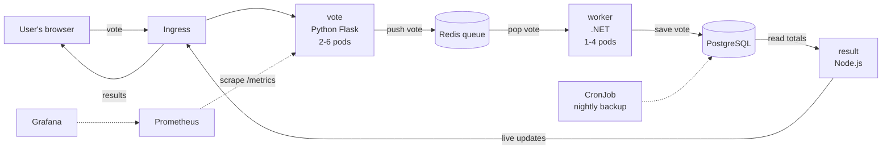

# Nephele: a cloud-native voting platform on Docker, Kubernetes and AWS

Nephele takes a small microservices application and runs it the way real
cloud systems run: in containers, orchestrated by Kubernetes, autoscaled,
monitored, tested and shipped by a CI/CD pipeline, with infrastructure on
AWS defined as code.

> **Credit.** The voting application itself (the `vote`, `worker` and `result`
> services) comes from Docker's open-source
> [example-voting-app](https://github.com/dockersamples/example-voting-app),
> Apache License 2.0. The original README is kept in
> [docs/UPSTREAM_README.md](docs/UPSTREAM_README.md). Nephele's contribution is
> the cloud platform around it and the small app changes listed below.

## How it works



1. A person opens the vote page and picks Cats or Dogs.
2. The **vote** service puts the vote on a **Redis** queue and answers at once.
3. The **worker** takes votes off the queue and saves them in **PostgreSQL**.
4. The **result** service reads the totals and pushes them live to the results page.

Each service runs in its own container and scales on its own.

## What is in this repository

| Path | What it is | Origin |
| --- | --- | --- |
| `vote/`, `worker/`, `result/` | The three application services | Upstream app, small Nephele changes |
| `docker-compose.yml` | Development stack with hot reload | Upstream |
| `docker-compose.nephele.yml` | Production-style stack + Prometheus/Grafana | Nephele |
| `k8s/base/` | Kubernetes: Deployments, StatefulSet, Services, Ingress, HPA, PDB, CronJob, NetworkPolicy | Nephele |
| `k8s/overlays/local` | Settings for the local kind cluster | Nephele |
| `k8s/overlays/aws` | Settings for Amazon EKS with RDS and ElastiCache | Nephele |
| `kind/cluster.yaml`, `scripts/` | One-command local cluster | Nephele |
| `infra/terraform/` | AWS: VPC, EKS, RDS, ElastiCache, ECR | Nephele |
| `.github/workflows/` | CI (test, build, scan, validate, publish) and CD to AWS | Nephele |
| `monitoring/` | Prometheus config and a Grafana dashboard | Nephele |
| `loadtest/k6-vote.js` | Load test that triggers autoscaling | Nephele |
| `vote/tests/` | Unit tests for the vote service | Nephele |
| `k8s-specifications/` | The upstream's original basic manifests, kept for comparison | Upstream |

### Changes made to the application code

- All three services read their database and Redis addresses and passwords
  from environment variables instead of hard-coded values, so Kubernetes and
  AWS can configure them.
- `vote` and `result` gained `/healthz` (liveness) and `/readyz` (readiness)
  endpoints for Kubernetes probes.
- `vote` exposes Prometheus metrics at `/metrics` (votes received, queue depth)
  and rejects unknown vote options.
- `result` had a missing `require('path')`, now fixed.

## Run it

### 1. Docker Compose (simplest)

```powershell
docker compose -f docker-compose.nephele.yml up -d --build
```

- Vote: http://localhost:8080
- Results: http://localhost:8081

Scale the worker and add monitoring:

```powershell
docker compose -f docker-compose.nephele.yml up -d --scale worker=3
docker compose -f docker-compose.nephele.yml --profile monitoring up -d
```

- Prometheus: http://localhost:9090
- Grafana: http://localhost:3300 (dashboard "Nephele overview")

### 2. Kubernetes on your laptop (kind)

Needs Docker Desktop, `kind` and `kubectl`.

```powershell
powershell -ExecutionPolicy Bypass -File scripts\kind-up.ps1
```

- Vote: http://vote.localtest.me:8888
- Results: http://result.localtest.me:8888

Useful demo commands:

```powershell
kubectl -n nephele get pods,svc,hpa,ingress,cronjob
kubectl -n nephele delete pod -l app=vote          # self-healing: pods come back
kubectl -n nephele create job --from=cronjob/db-backup backup-now   # run a backup now
kubectl -n nephele logs job/backup-now
k6 run loadtest/k6-vote.js                         # load test
kubectl -n nephele get hpa -w                      # watch autoscaling
```

Remove it with `scripts\kind-down.ps1`.

#### Queue-based worker autoscaling (KEDA, recommended)

The worker waits on Redis most of the time, so its CPU stays low even when
thousands of votes are queued, and the CPU autoscaler never adds workers.
KEDA scales it on the queue length instead (one worker per 50 waiting votes, 1 to 10):

```powershell
kubectl apply --server-side -f https://github.com/kedacore/keda/releases/download/v2.16.1/keda-2.16.1.yaml
kubectl -n nephele delete hpa worker
kubectl apply -k k8s/overlays/local-keda
```

Measured with the same 3-minute load test (`loadtest/results/`):

| | CPU autoscaler | KEDA (queue length) |
| --- | --- | --- |
| Votes sent / failed | 11,384 / 0 | 11,472 / 0 |
| p95 response time | 84.1 ms | 63.8 ms |
| Workers at peak | 4 (never scaled on load) | 10 |
| Most votes waiting in queue | 5,692 | 1,183 |
| Queue empty after load stopped | about 3.5 minutes | about 15 seconds |
| Votes lost | 0 | 0 |

### 3. AWS (EKS)

```powershell
cd infra/terraform
terraform init
terraform apply          # VPC, EKS, RDS, ElastiCache, ECR (paid resources)
```

Then put the `db_endpoint` and `redis_endpoint` outputs into
`k8s/overlays/aws/kustomization.yaml`, set the repository variables listed at
the top of `.github/workflows/nephele-cd-aws.yml`, and run the **nephele-cd-aws**
workflow. Run `terraform destroy` after the demo: EKS, RDS, ElastiCache and the
NAT gateway are billed by the hour.

## Tests

```powershell
docker build --target test -t nephele/vote:test vote
docker run --rm nephele/vote:test
```

## Cloud concepts shown

| Concept | Where |
| --- | --- |
| Microservices in three languages | `vote` (Python), `worker` (.NET), `result` (Node.js) |
| Asynchronous messaging | Redis queue between `vote` and `worker` |
| Containers | Dockerfiles, multi-stage builds, Compose |
| Orchestration | Kubernetes Deployments, StatefulSet, Services |
| Elasticity | HorizontalPodAutoscaler on `vote` and `worker` |
| High availability | 2+ vote replicas, PodDisruptionBudget, rolling updates with zero unavailable |
| Self-healing | Liveness and readiness probes |
| Persistent storage | StatefulSet volume for Postgres, backup volume |
| Scheduled jobs | Nightly `db-backup` CronJob |
| Network security | NetworkPolicies, Secrets, private subnets on AWS |
| Infrastructure as code | Terraform for VPC, EKS, RDS, ElastiCache, ECR |
| Managed cloud services | RDS (DBaaS), ElastiCache, ECR, EKS |
| CI/CD | GitHub Actions: test, build, scan, validate, publish, deploy |
| Observability | Prometheus metrics, Grafana dashboard |
| Portability | Same images and base manifests on a laptop and on AWS |

## License

Apache License 2.0, as the upstream project. See [LICENSE](LICENSE).
